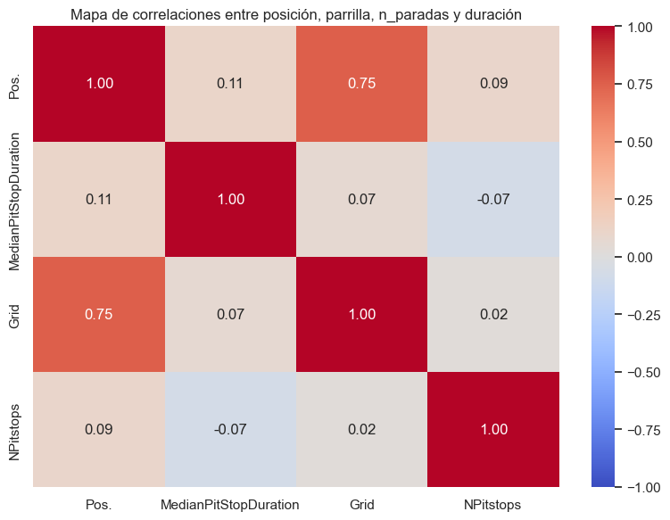
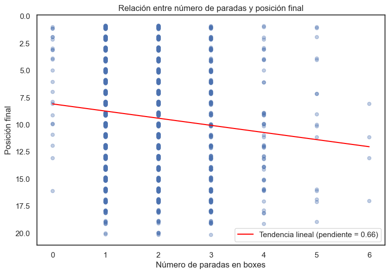
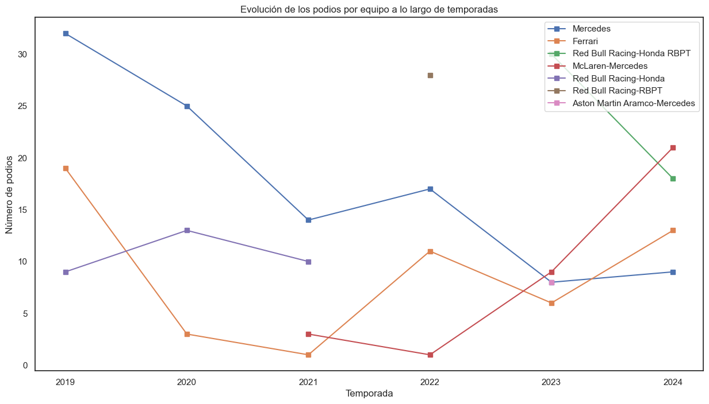

# PitWall

**A Formula 1 data pipeline that combines web scraping and a REST API to study how pit-stop strategy relates to race results (2019–2024).**


PitWall builds an analysis-ready dataset from two independent sources and then answers questions such as *does making fewer stops lead to better results?* and *how much does the starting grid matter?*

> Final project for the *Data Acquisition* course, Universidad Pontificia Comillas (ICAI).

---

## Pipeline

```
Wikipedia season pages ──► Scrapy spider ──► data/<year>/<round>_<GP>.csv   (race classification)
                                                        │
Jolpica (Ergast) F1 API ──► API client ──► data/<year>/round_<n>_API.csv    (pit stops per driver)
                                                        │
                                                        ▼
                                      merge by driver & race ──► Merged_data.csv ──► analysis notebook
```

**1. Web scraping (`apartado_scrapy/`)**: a Scrapy spider crawls the Wikipedia page of each season, finds the *Grands Prix* table with XPath (with fallbacks for layout changes across years), follows every *Report* link, and saves the *Race classification* table of each race as CSV. It respects `robots.txt` and uses a download delay.

**2. REST API (`jolpicaF1_api.py`)**: a client for the [Jolpica F1 API](https://api.jolpi.ca/ergast/f1/) (Ergast-compatible) that:
- downloads every pit stop round by round, with a **local JSON cache** and **HTTP 429 rate-limit handling** with retries,
- maps `driverId` to permanent car numbers per season,
- aggregates the number of stops and the **median stop duration** per driver and race.

**3. Integration**: joins scraped results and API data per season and round (driver names are normalised to API ids) into a single dataset.

## Findings

<p align="center">
  
  
</p>

- **The grid position decides most races.** Its Spearman correlation with the final position is **0.75**, compared with **0.09** for the number of stops and **0.11** for stop duration.
- **Fewer stops correlate with better finishes**, and most drivers make 1–3 stops.
- **Stop duration barely matters**: median stop times are similar (around 22–26 s) across all finishing positions.
- **More stops ≠ fewer points**: on average, drivers scored the most points with 4 stops, while 6 stops drops points sharply.

<p align="center">
  
</p>

Podium trends per team show Mercedes' decline after 2019, Ferrari's recovery, Red Bull's dominance under different team names, and McLaren's rise in 2024.

## Getting started

```bash
git clone https://github.com/javmartineez/PitWall.git
cd PitWall
pip install -r requirements.txt
python main.py          # scrape 2019–2024, call the API and build Merged_data.csv
```

Then open `analisis_ap4.ipynb` to reproduce the analysis. The scraped data, the API cache and the merged CSV are generated locally and are not versioned.

## Project structure

```
PitWall/
├── main.py                  # Runs the whole pipeline (scraping + API + merge)
├── jolpicaF1_api.py         # API client, cache, aggregation and dataset merge
├── apartado_scrapy/         # Scrapy project
│   └── spiders/f1_results.py
├── analisis_ap4.ipynb       # Exploratory analysis and conclusions
├── docs/images/             # Figures used in this README
└── requirements.txt
```

## Tech stack

Python · Scrapy (XPath) · requests · pandas · NumPy · Matplotlib · Seaborn · Jupyter

## Author

**Javier Martínez Berenguer** · [GitHub](https://github.com/javmartineez)
